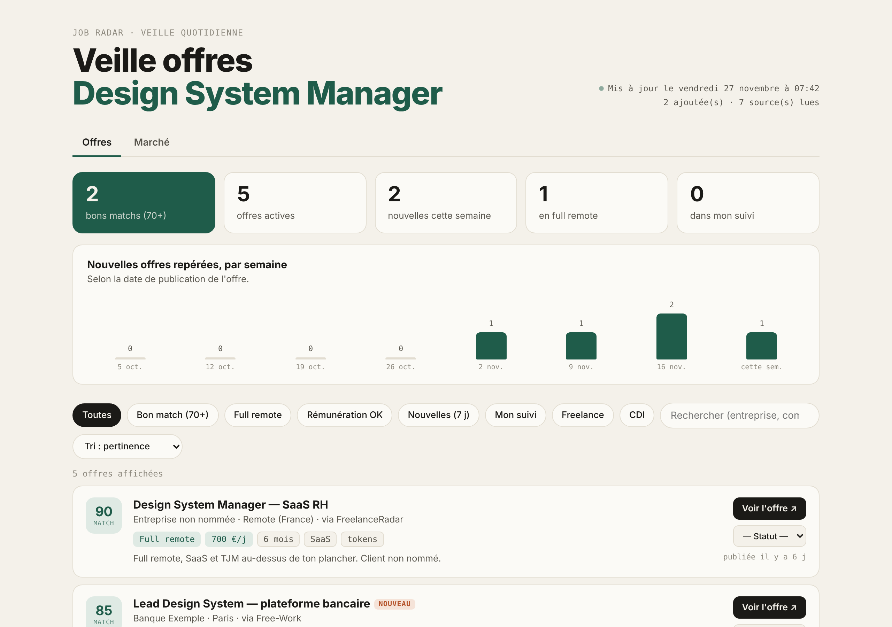
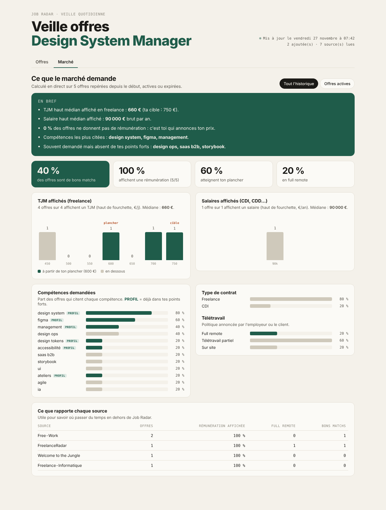

# Job Radar

**La veille d'offres qui tourne pendant que tu dors.** Job Radar est un skill pour Claude. Chaque matin, il lit les job boards publics, garde les offres qui correspondent à ton profil, les note de 0 à 100 et les range dans un tableau de bord. Il te prévient seulement quand une offre vaut vraiment le coup.

Il marche pour n'importe quel métier (product designer, design system manager, développeuse, data analyst, PM, marketing…) et pour tous les types de contrats : freelance, CDI, CDD, alternance, stage.



> Captures réalisées avec des données de démonstration fictives.

## Ce que fait Job Radar

- **Lit** une sélection de job boards et de recherches web adaptée à ton métier : Free-Work, FreelanceRadar, Welcome to the Jungle, Himalayas, We Work Remotely, et d'autres.
- **Trie** : il garde ton métier et tes contrats, écarte les offres expirées, hors zone ou en double.
- **Note** chaque offre selon un barème transparent : télétravail, rémunération (TJM ou salaire), sujet, séniorité, fraîcheur. Chaque note est accompagnée d'une phrase honnête qui explique pourquoi.
- **Affiche** un tableau de bord avec des filtres, ton suivi (« à postuler », « postulé », « entretien »…) et une vue **Marché** : rémunérations affichées, compétences les plus demandées, part du full remote.
- **Te prévient** sur ton téléphone quand une nouvelle offre dépasse ton seuil (70 par défaut), et reste silencieux sinon.

Job Radar ne postule jamais à ta place, ne contacte personne et ne se connecte à aucun site. Voir [SECURITY.md](SECURITY.md).



## Installation

### Dans l'app Claude (claude.ai, desktop, mobile)

1. Télécharge [`dist/job-radar.zip`](dist/job-radar.zip).
2. Ajoute-le à tes skills dans les réglages de Claude, si ton compte le permet.
3. Dans une nouvelle conversation, écris : **« Configure Job Radar pour moi »**.

Claude te pose cinq ou six questions (métier, contrats, ville et télétravail, rémunération, points forts). Il crée ensuite ton tableau de bord, fait un premier passage et programme la veille quotidienne.

Il te faut un compte Claude qui donne accès aux skills, aux artifacts et aux tâches planifiées. Chaque passage consomme de l'usage de **ton** compte.

### Dans Claude Code

```
/plugin marketplace add SachaMoke/job-radar
/plugin install job-radar@job-radar
```

Puis : « Configure Job Radar pour moi ». Dans Claude Code, Job Radar fonctionne en mode local : les données restent dans un dossier `job-radar-data/` et le tableau de bord est un fichier `job-radar-data/job-radar.html`.

### Avec un autre agent

Le dossier [`skills/job-radar`](skills/job-radar) suit le format ouvert des Agent Skills (`SKILL.md` et fichiers de référence). Tout agent qui sait lire ce format, naviguer sur le web et écrire des fichiers peut l'utiliser en mode local.

## Exemple : un Design System Manager à Paris

> « Configure Job Radar : je suis Design System Manager senior à Paris. Je cherche des missions freelance, 3 jours sur site maximum, TJM plancher 600 €, cible 750 €. Mes points forts : design system, design tokens, accessibilité, animation d'ateliers, management. »

Job Radar choisit des sources adaptées (Free-Work design, FreelanceRadar, Freelance-Informatique, plus des recherches comme « mission freelance design system Paris ») et propose des canaux à suivre à la main (Malt, Collective.work…). Il programme ensuite le passage du matin. Le fichier [`config.example.json`](skills/job-radar/assets/config.example.json) montre la config produite.

## Personnaliser

Tout se règle en parlant à Claude : « ajoute les CDI », « monte mon plancher à 650 € », « ajoute Welcome to the Jungle », « préviens-moi à partir de 80 ». Si tu préfères mettre les mains dedans :

| Fichier | Rôle |
|---|---|
| [`skills/job-radar/SKILL.md`](skills/job-radar/SKILL.md) | Point d'entrée et règles de sécurité |
| [`references/setup.md`](skills/job-radar/references/setup.md) | Configuration guidée |
| [`references/scan.md`](skills/job-radar/references/scan.md) | Déroulé du passage quotidien |
| [`references/scoring.md`](skills/job-radar/references/scoring.md) | Barème du score et format des offres |
| [`references/sources.md`](skills/job-radar/references/sources.md) | Catalogue de sources par métier |
| [`assets/dashboard.html`](skills/job-radar/assets/dashboard.html) | Le tableau de bord |
| [`scripts/build_local.py`](skills/job-radar/scripts/build_local.py) | Génère le tableau de bord en mode local |

## Limites (à connaître avant de s'y fier)

- **Couverture partielle.** Certains sites refusent la lecture automatique, d'autres n'affichent ni lien direct ni rémunération. Job Radar dégrossit ta veille, il ne la remplace pas : LinkedIn, Malt et ton réseau restent à faire à la main.
- **Le score est une aide, pas un verdict.** Il dépend de ce que l'annonce affiche. Une offre sans rémunération indiquée part avec moins de points.
- **Les sites changent.** Une adresse de source peut casser. Job Radar le signale dans la note du passage, et les contributions au [catalogue de sources](skills/job-radar/references/sources.md) sont bienvenues.
- **Coût.** Un passage lit des dizaines de pages. Il consomme de l'usage sur ton compte Claude, et pas qu'un peu.

## Contribuer

Nouvelles sources, nouveaux métiers, améliorations du tableau de bord : voir [CONTRIBUTING.md](CONTRIBUTING.md).

## Licence

[MIT](LICENSE). Libre d'utiliser, de modifier et de partager.

---

### English summary

Job Radar is a Claude skill that runs a daily job and gig watch for any profession and any contract type (freelance, permanent, fixed-term). It reads public job boards, filters and scores each offer against your profile, fills a dashboard with a market view, and pings you only when an offer clears your threshold. It never applies, contacts anyone or logs into any site. Install `dist/job-radar.zip` as a skill in the Claude app (or `/plugin marketplace add SachaMoke/job-radar` in Claude Code), then say "Set up Job Radar for me". The interface is in French; contributions for other languages are welcome.
